<div align="center">


<br>

### Ton Discord, mais qui te protège, qui va plus vite, et qui te dit tout ce qu'il fait.

Les liens piégés sont bloqués avant le clic, la télémétrie est coupée, la carte graphique est rendue à Discord,<br>
et ton groupe d'amis a un espace chiffré qui tient même quand Discord tombe.

**Installé en trente secondes. Sans droits administrateur. Ton Discord habituel reste intact.**

<br>


[**Installer**](#installation) &nbsp;·&nbsp; [**Site officiel**](https://nexium-client.netlify.app/) &nbsp;·&nbsp; [**État des services**](https://omega-devj.github.io/status-nexium/) &nbsp;·&nbsp; [**Notes de version**](CHANGELOG.md)

</div>

<br>

<div align="center">

| **439 000+** | **42** | **28** | **0** |
|:---:|:---:|:---:|:---:|
| domaines malveillants<br>connus et bloqués | protections<br>actives en fond | réglages de<br>confidentialité | droit administrateur<br>nécessaire |

</div>

<br>

---

<div align="center">

## Installation

**Une commande. Trente secondes.**

</div>

Ouvre **PowerShell** (touche Windows → tape `powershell` → Entrée) et colle :

```powershell
irm https://raw.githubusercontent.com/Omega-devj/nexium-client/main/install-nexium.ps1 | iex
```

<div align="center">

</div>

Le script ferme Discord, télécharge le client dans `%LOCALAPPDATA%\Nexium`, récupère le
lanceur, pose un raccourci sur le Bureau, et te propose de lancer Nexium tout de suite.
Si Nexium est déjà installé, il le met à jour **en gardant tes réglages**.

Nexium **démarre avec Windows**. L'interrupteur *Lancer Nexium avec Windows* du client le
coupe en un clic, et la page affiche ce que Windows a réellement retenu, pas une intention.

<details>
<summary><b>Installation manuelle, si tu préfères tout poser toi-même</b></summary>

<br>

1. Bouton vert **`Code` → `Download ZIP`**, décompresse où tu veux → `nexium-client-main`.
2. Récupère `Nexium.exe` dans l'onglet [Releases](../../releases).
3. Pose le `.exe` **à la racine** du dossier, à côté des autres fichiers — pas dans un sous-dossier.
4. Lance-le.

</details>

<br>

---

<div align="center">

## Un lien piégé ne s'ouvre pas


</div>

Loggers d'IP, faux cadeaux Nitro, domaines qui imitent une marque, liens masqués dont le
texte ment sur la destination : tout est analysé **sur ta machine, avant que tu cliques**,
contre une base de plus de **439 000 domaines**, tenue à jour. Un `.exe` renommé
en `.png` est repéré à son contenu réel, pas à son nom.

**Nexium Protect**, c'est 42 protections qui travaillent en fond, et chaque carte montre
combien de fois elle a agi :

- **Les arnaques sans lien.** Le faux support qui réclame ton code à six chiffres, le
  vendeur qui veut être payé « entre amis », celui qui te fait coller un code dans la
  console. Un détecteur reconnaît onze procédés de manipulation, **en français comme en
  anglais**, sans rien envoyer nulle part.
- **Douze secondes pour te rattraper.** Supprimer un serveur, couper la double
  authentification, changer d'e-mail ou de mot de passe, autoriser une application :
  la requête attend douze secondes, avec un bouton pour l'annuler.
- **Voir un lien sans l'ouvrir.** Clic droit → la chaîne de redirections, les formulaires,
  la demande de mot de passe, et l'âge du domaine. *« Enregistré il y a onze jours »* en
  face d'une page de connexion Discord se passe de commentaire.
- **Enquêter sur un auteur.** Âge du compte, serveurs en commun, signalements : un
  verdict, avec ce qui inquiète **et** ce qui rassure.
- **Et le reste.** Usurpation d'amis, vagues de messages privés coordonnées, fuites de
  jeton ou de webhook, QR codes piégés, caractères invisibles, serveurs piégés.

<br>

---

<div align="center">

## Rien ne sort sans que tu le saches



</div>

**Nexium Privacy**, c'est 28 réglages, du blocage de la télémétrie jusqu'à l'empreinte
matérielle normalisée et aux noms de fichiers anonymisés à l'envoi. Cinq gardes de sortie
surveillent ce qui quitte ta machine : webhooks, requêtes vers des serveurs inconnus,
balises invisibles, scripts injectés, code qu'un thème voudrait exécuter.

Trois profils (**strict**, **équilibré**, **minimal**), des **heures discrètes** qui
basculent le profil toutes seules, tes dernières 24 heures et ta semaine en courbes, et
un **journal** qui liste chaque blocage, un par un.

<br>

---

<div align="center">

## Discord, enfin fluide

</div>

Le démarreur sur lequel repose Nexium coupait l'accélération matérielle : tout Discord était
dessiné par le processeur. Images qui tombent, défilement qui accroche, lettres qui mettent
du temps à apparaître. **Nexium rend la carte graphique à Discord**, et va plus loin avec
**Nexium Ultra Fast** :

- la **carte graphique dédiée** sur les portables qui en ont deux ;
- la rasterisation confiée à la carte graphique, et une **priorité processus** relevée ;
- des colonnes qui ne recalculent plus leur mise en page quand la discussion bouge ;
- la **frappe mesurée touche par touche**, avec la cause d'un ralentissement dite en une phrase ;
- les **images par seconde mesurées** sur ta machine, avant et après.

Chaque levier se coupe séparément, et un interrupteur rend tout au rendu logiciel si ton
pilote graphique pose problème.

<br>

---

<div align="center">

## Le vocal, comme Discord ne te le montre pas

</div>

- **Le best-of de l'appel.** Le client garde les trois dernières minutes en mémoire vive,
  repère les fous rires à leur cadence et les moments où tout le monde parle en même
  temps, et en fait un clip de 23 secondes — puis une vidéo prête à poster. Rien n'est
  écrit sur le disque si rien ne se passe.
- **Le soundboard partout, sans Nitro.** Vingt-quatre sons gardés sur ta machine, les
  neuf premiers sur `Ctrl + Maj + 1` à `9`. Avec un câble audio virtuel, les autres
  n'entendent que le son ; sans, la carte t'explique quoi activer.
- **Les gros fichiers passent.** Une vidéo de 200 Mo est réduite pendant que tu continues
  à taper. Si tu as déjà Nitro, ce module ne fait rien.
- **Nexium Vocal.** Le vrai serveur qui relaie ta voix, son port, le chiffrement de bout
  en bout (DAVE), les codecs, le débit, les pertes et la gigue personne par personne, et
  une alerte quand la qualité se dégrade.

<br>

---

<div align="center">

## Ton groupe existe au-dessus de Discord

</div>

**Le Repaire** : ta bande d'amis installe Nexium et partage un fil, des notes, des liens,
des sondages et des rendez-vous, dans n'importe quel serveur, sans rien créer et sans
rien demander à Discord.

Le relais qui transporte tout ça **ne peut pas le lire**. Le code d'invitation produit une
clé AES-GCM qui ne quitte jamais ta machine : le serveur ne stocke que du chiffré, et les
messages s'effacent à l'échéance que tu as choisie (une heure, un jour, trente jours).

Et quand Discord tombe, **la ligne de secours** prend le relais : les clients Nexium
continuent de se joindre. Le client interroge deux réseaux sans rapport avant de parler,
pour te dire si la panne vient de Discord ou de ta connexion, au lieu d'accuser Discord
à tort.

<br>

---

<div align="center">

## Un assistant qui agit, et qui sait revenir en arrière

</div>

**Nexium IA** répond à tes questions sur le client, et agit dessus : *« mets le mode
économie »*, *« pourquoi ce bandeau ? »*, *« combien de messages cette semaine ? »*.

- **Le plan avant d'agir.** Il écrit toutes les étapes avant de toucher à quoi que ce
  soit. Tu décoches ce que tu refuses, tu valides une fois.
- **La marche arrière.** Dis *« annule »* : chaque changement est défait, du plus récent
  au plus ancien.
- **Une case par outil.** Ce que tu décoches ne part même pas dans la demande.
- **Rien sans ton accord.** Pour lire un salon, il te montre d'abord les messages exacts
  qui partiraient, jetons et clés déjà masqués, pseudos remplacés par des lettres.

Les questions simples sont traitées **sur ta machine, gratuitement**, et la bulle le
signale. Le relais ne garde aucune conversation.

<br>

---

<div align="center">

## Et encore…

</div>

| | Module | Ce qu'il fait |
|---|---|---|
| 🧪 | **Bac à sable** | Un fichier lu octet par octet, **sans jamais être exécuté** : type réel, entropie, structure des exécutables et des archives (détection d'une archive-bombe *avant* de décompresser), douze règles de détection. |
| 🧰 | **Boîte à outils** | Une vingtaine d'outils : base64, JWT, empreintes SHA, mots de passe, DNS, certificats, en-têtes HTTP. Chacun dit avant de s'exécuter si quelque chose quitte ta machine. |
| 📈 | **Sismographe** | Clic droit sur un serveur → sa santé : il s'éteint, il se vide, il grandit, ou il subit un afflux de comptes neufs (la forme d'un raid). |
| 👥 | **Amis** | Le jour où ta liste d'amis a rétréci, et chaque changement de pseudo, daté. |
| ⚡ | **Auto** | Automatisations, mode focus avec sessions minutées. |
| 🎧 | **Music** | Lecteur intégré, playlist, mini-lecteur déplaçable. |
| 📊 | **Stats** | Ton activité, calculée et gardée **uniquement sur ta machine**. |
| 📡 | **Réseau** | Latence, gigue, stabilité, et la liste en direct des hôtes contactés. |
| 💾 | **Données** | Tout ce qui est stocké, export/import des réglages, journal d'erreurs, diagnostic. |
| 🎫 | **Support** | Des tickets, avec une réponse de l'équipe directement dans le client. |

Plus **plusieurs centaines de plugins Equicord** déjà intégrés, et tout suit ton thème
Discord : clair, sombre, thèmes personnalisés et QuickCSS.

`Ctrl + Maj + N` ouvre la recherche rapide : une page, une protection, les mises à jour,
l'export des réglages… Tout se parcourt au clavier, et chaque page a un bouton
**« À quoi ça sert ? »** qui dit ce qu'elle fait, ce qu'elle change, et ce qu'elle ne
fait **jamais**.

<br>

---

<div align="center">

## C'est gratuit ?

</div>

**La protection, oui, pour toujours.** Sans abonnement, tu gardes le socle protecteur :
liens dangereux, hameçonnage, fichiers piégés, garde de la console, coffre anti-vol,
blocage de la télémétrie de base. Avec Nexium, tu n'es jamais moins protégé qu'avec un
Discord nu.

Les offres **Nexium Plus**, **Pro** et **Ultra**, ou par module à partir d'un euro
(IA, Privacy, Security), ouvrent les paliers avancés. Un **essai gratuit de trois jours**
est proposé, et la page *Nexium Abonnement* montre exactement ce que chaque offre ouvre
avant que tu payes quoi que ce soit.

<br>

---

<div align="center">

## Ce qui sort de ta machine

*Plutôt que de promettre « zéro donnée », voici la liste exacte.*

</div>

| | Quand | Ce qui part |
|---|---|---|
| **Enregistrement** | Au démarrage | Ton identifiant Discord et la version du client |
| **Badge Nexium** | Quand des profils s'affichent | Les identifiants Discord de ces profils, pour savoir lesquels utilisent Nexium |
| **Signalement** | **Seulement si tu cliques sur « Signaler »** | Le domaine signalé, son type, ton identifiant et ton pseudo |
| **Nexium IA** | **Seulement quand tu poses une question** | Ta question et le contexte que tu as autorisé, montré tel quel avant l'envoi |
| **Bac à sable de liens** | **Seulement quand tu inspectes un lien** | L'adresse inspectée. Le relais va chercher la page à ta place : le site ne voit pas ton IP |
| **Repaire** | Quand tu l'utilises | Des messages **chiffrés sur ta machine** : le relais ne peut pas les lire |
| **Support** | Quand tu ouvres un ticket | Ce que tu écris dans le ticket |

**Jamais envoyé** : aucun message de tes conversations, aucun jeton, aucun mot de passe,
aucune statistique d'usage, aucun traceur tiers.

**Téléchargé, sans rien envoyer** : la base de menaces, la liste blanche, la liste de
bannissement, les notes de
version et les mises à jour.

> Le code de Nexium (le lanceur, les modules, les relais) est lisible dans ce dépôt, et
> Nexium Réseau te montre en direct chaque requête que le client émet.

<br>

---

<div align="center">

## À savoir avant d'installer

*De vraies contraintes, pas des formalités.*

</div>

- **Ce client modifie Discord**, ce qui va à l'encontre de ses conditions d'utilisation.
  Un bannissement reste théoriquement possible. En pratique c'est rare, mais le risque
  n'est jamais nul.
- **Le client se met à jour tout seul** : à chaque démarrage il télécharge la dernière
  version depuis ce dépôt et l'exécute. Tu fais donc confiance au mainteneur **pour le
  code qu'il publiera demain**, pas seulement pour celui d'aujourd'hui.
- **Le `.exe` n'est pas signé.** SmartScreen et certains antivirus le signaleront.
  C'est attendu pour ce type d'outil, à toi d'en juger.
- **Windows uniquement.**

<br>

---

<div align="center">

## Des mises à jour qui ne cassent rien

</div>

À chaque lancement, le client récupère la dernière version et l'applique **avant** de
démarrer Discord. Une version n'est appliquée que si elle passe tous les contrôles :
numéro strictement supérieur, taille suffisante, modules attendus présents, fonctions
critiques en place, et somme de contrôle conforme. Sinon, la version installée est
conservée.

Trois filets : **sauvegarde** de la version précédente, **auto-réparation** si le fichier
est corrompu, et **retour arrière** depuis Nexium Mise à jour. Le lanceur lui-même se
met à jour avec un chien de garde : s'il n'arrive pas à démarrer, la version précédente
revient toute seule. Et une [**page de statut publique**](https://omega-devj.github.io/status-nexium/)
affiche un bandeau dans le client dès qu'un incident est déclaré.

<details>
<summary><b>Figer ta copie (si tu bricoles le code)</b></summary>

<br>

Crée un fichier vide `.nexium-dev` dans `resources/equicord` : les mises à jour
automatiques s'arrêtent et tes modifications locales sont conservées. Supprime-le pour
réactiver. Le journal `resources/equicord/.nexium-update.log` raconte à chaque lancement
ce qui s'est passé.

</details>

<br>

---

## En cas de problème

<details>
<summary><b>Le client rame ou se comporte mal</b></summary>

<br>

`Ctrl + Maj + N` → *Désactiver la restauration des icônes de plugins*. C'est la seule
fonction qui intervient dans l'interface de Discord. Si l'image saccade, coupe aussi
l'accélération matérielle dans Nexium Données.

Si Discord redémarre plusieurs fois d'affilée, le **mode sécurisé** s'active seul,
coupe les fonctions à risque, et les rend dès que tout va mieux.

</details>

<details>
<summary><b>Savoir si ça vient de Nexium ou de Discord</b></summary>

<br>

Ferme Discord, renomme `resources/equicord/renderer.js` en `renderer.js.off`, crée un
fichier vide `.nexium-dev` à côté, relance. Si le problème persiste, il ne vient pas de
Nexium. Remets tout ensuite.

</details>

<details>
<summary><b>Remonter un bug utilement</b></summary>

<br>

Nexium Données → *Journal des erreurs* → **Copier tout**, puis joins-le à une
[issue](../../issues) ou à un ticket depuis la page Support. Les erreurs de la session
précédente y figurent aussi, même après un plantage.

</details>

<details>
<summary><b>Autres problèmes courants</b></summary>

<br>

| Problème | Solution |
|---|---|
| SmartScreen bloque le `.exe` | « Informations complémentaires » → « Exécuter quand même » |
| Le `.exe` ne démarre pas | Vérifie qu'il est à la **racine** du dossier |
| Discord classique déjà ouvert | Ferme-le complètement (clic droit près de l'horloge → Quitter) |
| Rien ne se met à jour | Ouvre `resources/equicord/.nexium-update.log` : il dit à chaque lancement ce qui s'est passé |

</details>

<details>
<summary><b>Désinstaller</b></summary>

<br>

1. Dans le client, coupe **Lancer Nexium avec Windows**. Pour effacer aussi tes
   réglages : Nexium Données → *Tout effacer*.
2. Ferme Discord.
3. Supprime le dossier `%LOCALAPPDATA%\Nexium` et le raccourci du Bureau.

Si tu as supprimé le dossier sans couper le démarrage automatique, retire l'entrée
restante depuis PowerShell :

```powershell
reg delete "HKCU\Software\Microsoft\Windows\CurrentVersion\Run" /v "Nexium Client" /f
```

</details>

<br>

---

## Questions fréquentes

<details>
<summary><b>Est-ce que c'est un virus ?</b></summary>

<br>

Non. Le `.exe` lance Discord avec du code supplémentaire, que tu peux lire dans ce dépôt.
Il n'est pas signé numériquement (la signature coûte cher et peu de projets
communautaires la paient), ce qui déclenche des alertes automatiques de Windows sans que
le fichier soit malveillant. Modifier Discord correspond par ailleurs à des comportements
que les antivirus surveillent, même légitimes.

</details>

<details>
<summary><b>Est-ce que ça casse mon Discord actuel ?</b></summary>

<br>

Non. Nexium tourne à côté et ne touche pas à ton installation officielle. Compte,
serveurs et réglages restent intacts, et tu peux revenir au Discord normal à tout moment
en rouvrant celui que tu utilisais.

</details>

<details>
<summary><b>Est-ce que ça ralentit Discord ?</b></summary>

<br>

Au contraire, le plus souvent : Nexium rend la carte graphique à Discord. Vérifier un
lien coûte quelques microsecondes, la base de menaces est chargée par tranches pour ne
jamais figer l'interface, et les minuteries se suspendent quand Discord passe en
arrière-plan. La carte *Fluidité* de Nexium Données mesure le coût de chaque partie de
Nexium sur ta machine.

</details>

<details>
<summary><b>Compatible avec Vencord ou BetterDiscord ?</b></summary>

<br>

Nexium est un client autonome qui embarque déjà les plugins Equicord. Faire tourner
plusieurs clients modifiés en parallèle provoque des conflits, ce n'est pas recommandé.

</details>

<details>
<summary><b>Mac ou Linux ?</b></summary>

<br>

Pas pour le moment. Windows uniquement.

</details>

<details>
<summary><b>Comment être sûr de télécharger la bonne version ?</b></summary>

<br>

Seuls ce dépôt et [nexium-client.netlify.app](https://nexium-client.netlify.app/) font
foi. Si tu as trouvé le client ailleurs, reviens vérifier ici avant d'installer. En cas
de doute, la [page d'état](https://omega-devj.github.io/status-nexium/) indique la
version réellement publiée.

</details>

<br>

---

## L'équipe

| | |
|---|---|
| **5dj0** | Créateur et développeur principal |
| **kikou** | Développeur C++ / Lua / Luau |
| **ryukuro** | Communication, support et QA |
| **elias.qsd7** | Idées et retours |

Un bug, une question, une idée ? Ouvre une [issue](../../issues), un ticket depuis la
page Support du client, ou rejoins la communauté depuis la page **Nexium Sponsor**.

<br>

---

<div align="center">

### Prêt à reprendre Discord en main ?

</div>

```powershell
irm https://raw.githubusercontent.com/Omega-devj/nexium-client/main/install-nexium.ps1 | iex
```

<div align="center">

<br>

**Nexium Collective** &nbsp;·&nbsp; [nexium-client.netlify.app](https://nexium-client.netlify.app/) &nbsp;·&nbsp; [État des services](https://omega-devj.github.io/status-nexium/)

Basé sur [Equicord](https://github.com/Equicord/Equicord) · Licence [GPL-3.0](LICENSE)

</div>
